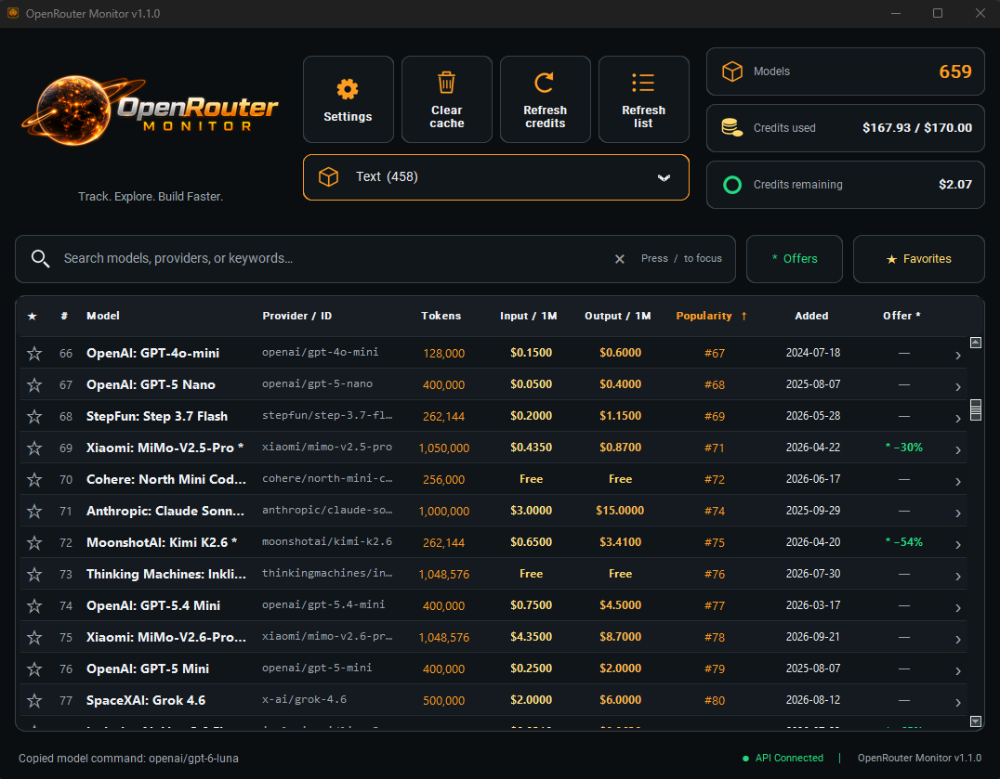

# OpenRouter Monitor

<p align="center">
  
</p>

A Windows desktop app for browsing OpenRouter models across output categories, comparing prices, tracking credits, and copying the exact model identifier with one click.

## Download

[Download OpenRouter Monitor v1.1.0 for Windows](https://github.com/ArthurReboulSalze/OpenRouter-Monitor/releases/tag/v1.1.0).

Extract the portable ZIP and run **OpenRouter Monitor.exe**. Python is not required for the executable. Your existing settings and favorites are reused automatically.

## Features

- Dark and amber UI based on the supplied design, with the new Windows application and tray icon
- Fast model listing with search, a clear button, sorting, and favorites
- Category selector: Text, Image, Video, Speech, Decisions, Embeddings, Rerank, Transcription, and Audio
- Official OpenRouter popularity ranking and sortable model addition dates
- Promotional offers marked with an asterisk, their discount percentage, a dedicated filter, and sorting
- Color-coded `Tokens`, `Input / 1M`, and `Output / 1M`
- One-click copy of the exact OpenRouter model id
- Credit usage and remaining credit display
- Local cache for fast startup
- System tray integration with credit summary tooltip
- Simple settings dialog for startup, tray behavior, and credit refresh timer

## Requirements

- Windows 10 or Windows 11
- Python 3.10+ to run from source
- An OpenRouter API key for live account credit data (model browsing works without a key)

## Setup

Install dependencies:

```bash
pip install -r requirements.txt
```

Create your local environment file:

```bash
copy .env.example .env
```

Set your OpenRouter API key in **Settings**, or supply an initial default in `.env`:

```env
OPENROUTER_API_KEY=sk-or-v1-xxxxxxxx
```

A key saved in Settings takes precedence over the `.env` default. Your existing settings, favorites, and model cache remain in the same user data directory.

## Run From Source

```bash
python run.py
```

## Build the Windows Executable

```bash
pip install pyinstaller
python build.py
```

Output:

```text
dist/OpenRouter Monitor.exe
```

## Main Files

- `openrouter_monitor_gui.py` - main application
- `run.py` - local launcher
- `build.py` - PyInstaller build script
- `OpenRouter Monitor.spec` - PyInstaller spec file
- `installer.iss` - Inno Setup installer script

## How To Use

- Click the star to add or remove a favorite
- Click a column header to sort
- Type in the search bar to filter models
- Search names, provider IDs, descriptions, and output categories
- Click the cross or press Escape in the search field to clear it; `/` or Ctrl+F focuses search
- Choose a category from the dropdown below the action buttons
- Click **Popularity** to sort by OpenRouter's official most-popular order (lowest rank first)
- Click **Added** to show the newest additions first; click again to reverse
- Click **Offers** to show promotional models, and **Offer \*** to sort by the largest discount first
- Click a model row to copy the exact OpenRouter model id
- Click the right-hand chevron to open the model's full pricing and provider details
- Use `Refresh credits` and `Refresh list` to update data manually
- Press F5 to refresh the catalog, ranking, and promotions
- Edit your API key in **Settings**

## Local App Data

User data is stored in:

```text
%USERPROFILE%\.openrouter_monitor\
```

Important files:

- `config.json`
- `favorites.json`
- `models_cache.json`
- `app.log`

## Notes

- The public model catalog refreshes without an API key; account credits require a valid key
- Categories use output modalities: a model that understands video and generates text belongs to Text; a model that generates video belongs to Video
- Popularity is the ordering from OpenRouter's `most-popular` catalog, not a quality score or a count of local favorites
- Addition dates are OpenRouter's `created` timestamps displayed in UTC
- Promotions come from [OpenRouter's discounted model collection](https://openrouter.ai/collections/discounted-models). The collection may list only a subset of active offers. Badges are rechecked on catalog refresh and expire after 24 hours in a cached catalog
- Prices shown for offers already reflect the current catalog price; the discount is informational and is not applied a second time
- Speech input may be billed per million characters. Video, transcription, and reranking use other billing units: the table shows **See rates** and the chevron opens their full pricing
- Live credit information depends on the OpenRouter endpoints available for your key
- The project is designed for Windows and the UI is optimized for that environment

## Validation

```bash
python -m unittest discover -s tests -v
python -m py_compile openrouter_monitor_gui.py model_catalog.py monitor_theme.py build.py
```

GitHub Actions runs the catalog tests and Python compilation checks on Windows for pushes, pull requests, and version tags. GUI and executable smoke checks are performed locally on Windows.
